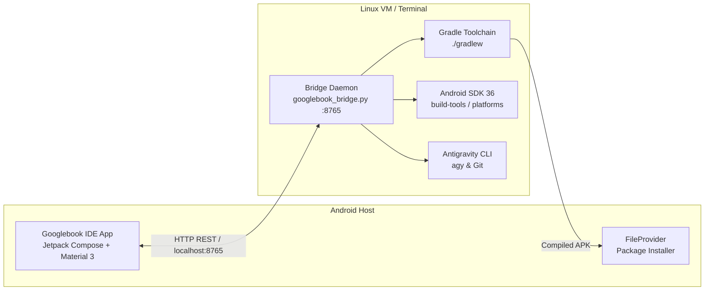

# Googlebook IDE 🚀

**Googlebook IDE** is a modern, high-performance IDE built for Android devices (Chromebooks, Android Laptops, and tablets) that enables hands-on Android development, live compilation with Gradle, on-device APK deployment, and native integration with **Google Antigravity CLI**.

---

## ✨ Features

- **📱 On-Device Compilation & Deployment**:
  - Direct 1-tap compilation of Android applications via Gradle (`assembleDebug`, `assembleRelease`, `clean`, `test`).
  - Automatic cache redirection to native `ext4` storage (`~/.cache/projects/...`) to ensure fast, low-overhead builds on Android FUSE / `virtiofs`.
  - Direct on-device APK installation via Android `FileProvider` and Package Installer.
- **⚡ Antigravity AI Assistant & CLI Integration**:
  - Embedded AI assistant for real-time coding guidance, architectural review, and code generation.
  - Native support for Antigravity slash commands:
    - `/plan <task>`: Formulate step-by-step TDD engineering plans.
    - `/goal <task>`: Configure long-running autonomous development goals.
    - `/schedule`: Set up recurring verification tasks and timers.
    - `/build`: Trigger an immediate Gradle APK compilation.
    - `/test`: Run JVM and Robolectric unit test suites.
    - `/help`: Quick reference for Antigravity CLI features.
  - Interactive "Insert Code into Editor" action for instant code insertion.
- **🎨 Modern Jetpack Compose Code Editor**:
  - Multi-tab file editing with dirty/unsaved change indicators.
  - Dynamic line number gutter with synchronized scrolling.
  - Real-time syntax highlighting for Kotlin, XML, Gradle (`.kts`), JSON, and Markdown.
  - Quick Compose snippet bar (`@Composable`, `remember { mutableStateOf() }`, `Button`, `Column`, `Row`, `Card`, `Text`).
- **📂 Android Project Explorer & Scaffolding**:
  - Workspace file tree navigation for all projects under `/storage/emulated/10/Documents/Antigravity Apps`.
  - Contextual file type icons (Kotlin, XML, Gradle, JSON, Markdown).
  - Built-in "New Android Project" wizard generating modern Jetpack Compose + Material 3 project templates.
- **💻 Integrated Terminal & Problem Panel**:
  - Live streaming Gradle build logs with ANSI color parsing and status banners.
  - Interactive terminal executing bash commands directly in the Linux VM development environment.
  - Problems tab extracting compilation errors and line numbers for rapid navigation.
- **🌿 Git Version Control**:
  - Branch tracking, file change status inspection, commit messaging, and GitHub push/pull operations.

---

## 🛠️ Architecture



---

## 🚀 Getting Started

### 1. Launch the Bridge Daemon (Linux VM)
In the Android Terminal VM, start the companion bridge daemon:

```bash
cd "/storage/emulated/10/Documents/Antigravity Apps/Googlebook IDE"
./start_bridge.sh
```

The daemon listens on `http://127.0.0.1:8765` and coordinates build tasks, git commands, and Antigravity AI calls.

### 2. Install Googlebook IDE on Android
Once built, the APK is located at:
`app/build/outputs/apk/debug/GooglebookIDE-debug.apk`

Open the APK in the Android file manager or tap **Deploy on Device** inside the IDE to install and launch.

---

## 🧪 Testing

Googlebook IDE is engineered with a strict **Test-Driven Development (TDD)** lifecycle:

```bash
./gradlew testDebugUnitTest --project-cache-dir="$HOME/.cache/projects/$(basename "$PWD")-$(pwd -P | sha1sum | cut -c1-8)/gradle"
```

Unit test suites cover:
- `GradleCommandBuilderTest`: Validates cache redirection flags and APK path resolution.
- `BuildLogParserTest`: Validates ANSI stripping, success/failure detection, and compiler error extraction.
- `SyntaxHighlighterTest`: Validates lexical tokenization of Kotlin, XML, and Gradle files.
- `SlashCommandHandlerTest`: Validates slash command parsing and argument extraction.
- `AndroidProjectTemplateGeneratorTest`: Validates automated project scaffolding.

---

## 📄 License
MIT License. Created by Brad Christensen (`bradlchr`).
